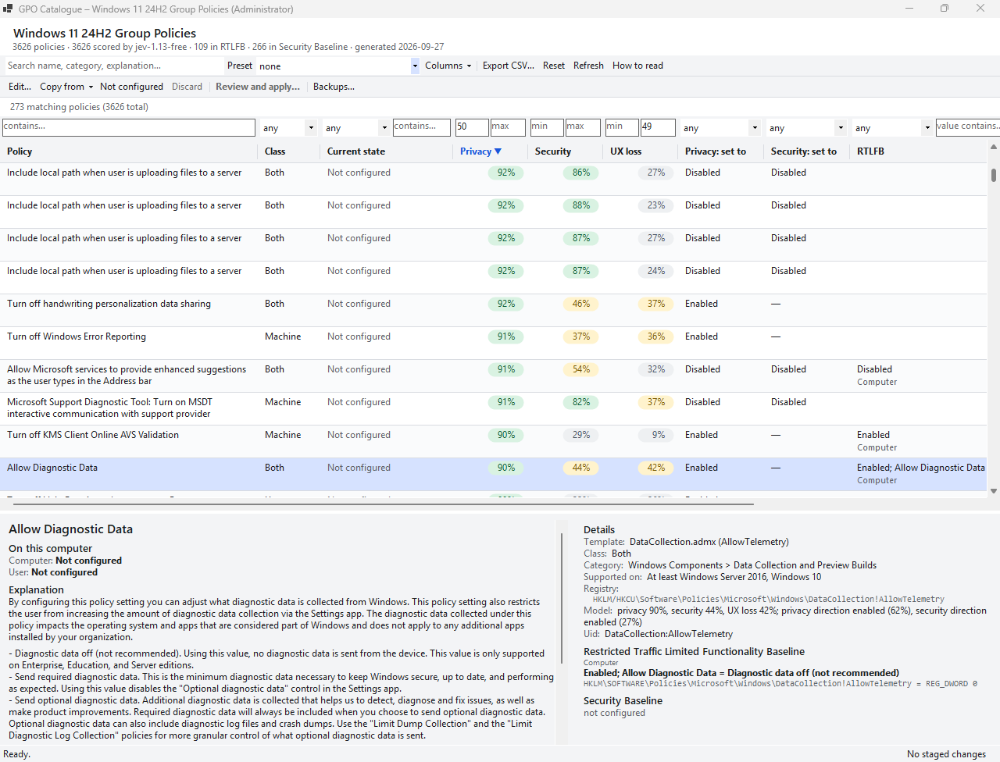

# Windows Privacy by Jev

An experiment: ask the model **Jev** to grade every one of the 3626 Administrative Template group policies
of Windows 11 24H2, then put its grades next to what Microsoft's own baselines do and what this computer
is actually set to.

For each policy, Jev gives three probabilities:

- **Privacy**: does configuring the policy improve privacy?
- **Security**: does configuring it improve security?
- **UX loss**: would the restrictive setting take away functionality? Less telemetry or fewer ads alone
  doesn't count as a loss.

It also names the state it considers most private and most secure: Enabled, Disabled, or neither.
Jev's answers sit beside two Microsoft references, both decoded from their `registry.pol` files:

- the **Restricted Traffic Limited Functionality Baseline** (RTLFB);
- the **Windows 11 24H2 Security Baseline**.

The main piece is a Windows desktop app that shows all of this together with the current state of each
policy, and lets an administrator apply Jev's or a baseline's setting. A static website with the same
catalogue, without the current state or editing, is included too.



*The "Privacy ≥ 50%, UX loss < 50%" preset: 273 policies Jev considers good for privacy at little cost,
sorted by privacy grade, with what RTLFB does and what this computer is set to.*

## The app

A Windows Forms program (.NET 10, x64) under `app/`.

### What it shows

- **The catalogue:** every policy with its category, class (Computer, User or Both), Jev's grades as
  percentages, Jev's recommended state, and what each baseline sets it to.
  - Search covers the name, category and explanation.
  - Every column can be filtered and sorted.
  - Presets pick out the useful slices: privacy or security wins at low UX cost, privacy wins RTLFB leaves
    out, and what either or both baselines configure.
  - Columns can be shown or hidden, and the current view can be exported as CSV.
- **The current state** of every policy on this computer, read from the local group policy
  (`%SystemRoot%\System32\GroupPolicy\{Machine,User}\Registry.pol`) and checked against the registry.
  "Not applied" means the registry disagrees. "Registry only" means policy values are present that local
  group policy didn't set. The baseline filters can also pick policies whose current state matches or
  differs from a baseline.
- **A detail pane** for the selected policy: its explanation, its template and registry values, Jev's
  answers, each baseline's exact entries, and the policy objects and registry values found on this computer.

### Changing policies

Changes need administrator rights. Nothing is written until you have reviewed the differences.

- **Edit…** (Enter or double-click) opens a dialog like the Group Policy editor's: Not configured, Enabled
  or Disabled, plus every option of the template.
- **Copy from** stages, for every selected row, one of these:
  - the Security Baseline's exact registry entries;
  - RTLFB's exact registry entries;
  - Jev's recommended state for privacy or for security. Jev only picks Enabled or Disabled, so options
    take the template's defaults and are flagged for review. When a required option has no default, the
    change is marked "needs input".
- **Review and apply…** lists every staged change: current and new state, source and notes, every registry
  value it touches, and any other policy that changes along with it because they share values. Changes can
  be unticked. Applying then:
  1. backs up the policy files;
  2. writes through the Group Policy API (`IGroupPolicyObject`), so `gpedit.msc` sees the result;
  3. refreshes policy and checks that the registry followed.
- **Backups…** restores any earlier state through the same review.

Without administrator rights the app is read-only. Changes can still be staged and reviewed, and
**Restart as administrator** carries them over.

### Things to know

- **Values that stay behind:** about 80 policies (MSS-legacy, SecGuide and a few stock ones) write outside
  the registry keys reserved for policy. Setting them to Not configured leaves the last value in place, as
  it does in the Group Policy editor. The review dialog warns about this.
- **Templates `gpedit.msc` doesn't list:** policies from templates that aren't installed in
  `C:\Windows\PolicyDefinitions` (the baselines' own templates and a few others) still apply, but
  `gpedit.msc` doesn't show them. The detail pane says so.
- **Close `gpedit.msc` before applying.** It keeps its own copy of the policy and would overwrite the
  change. The app won't apply while it's open.
- **Scope:** only the local group policy is covered. Domain policy, per-user local policy and settings
  outside Administrative Templates (Security Options, Audit, Firewall) are not.
- **Jev's grades are one model's opinion.** Read the explanation before applying a recommendation.

### Build and run

Requires the .NET 10 SDK.

```sh
cd app
dotnet run --project src/GpoCatalogue.App
dotnet publish src/GpoCatalogue.App -c Release -r win-x64 --self-contained -p:PublishSingleFile=true \
  -p:IncludeNativeLibrariesForSelfExtract=true -p:EnableCompressionInSingleFile=true -o publish
```

The publish command produces `app/publish/GpoCatalogue.exe`, a single file of about 50 MB that runs
without .NET installed.

The catalogue is embedded at build time from `data/desktop.json.gz`, which the `desktop` pipeline stage
produces (see below). It contains:

- the full template definitions and the dialog defaults;
- Jev's answers;
- the raw baseline entries.

Command line:

```
GpoCatalogue.exe [--gpo-root <folder>] [--data <folder>] [--read-only] [--theme light|dark]
                 [--select <uid>] [--export-csv <file>]
```

- `--gpo-root` works on a copy of a GroupPolicy folder instead of this computer's policy. The UI tests use
  it to exercise editing without touching the machine.
- The view and staged changes are kept in `%LOCALAPPDATA%\GpoCatalogue`.
- Backups are kept in `%ProgramData%\GpoCatalogue\Backups`.

### Tests

```sh
cd app
dotnet test --project tests/GpoCatalogue.Tests/GpoCatalogue.Tests.csproj    # core, 141 tests
dotnet build tests/GpoCatalogue.UiTests && tests/GpoCatalogue.UiTests/bin/Debug/net10.0-windows/win-x64/GpoCatalogue.UiTests.exe
```

- **Decoding:** the core tests hold the C# decoder to the published states of all 375 baseline settings.
- **Encoding:** re-encoding a decoded baseline must give back its registry entries. 365 do exactly; the
  other 10 are quirks of the baseline files and are listed in the test.
- **Views:** filtering, sorting, presets and CSV are checked against the real website, recorded by
  `node tools/site-golden.js`.
- **Real policy (administrator only):** `ElevatedGpoTests` and the elevated UI tests change policies of
  components a test machine doesn't use (NetMeeting, App-V, Windows Media Player, SNMP) through the real
  API. They check the result with `tools/decode_pol.py`, the registry and `gpt.ini`, then restore the
  original state. These tests are skipped without administrator rights.
- **UI tests:** they drive the app only through UI Automation, so they send no keystrokes or mouse clicks
  to whatever window is in front.

## The website

`site/index.html` shows the same catalogue, grades and baselines, without the current state or editing.
Open it directly in a browser; it works from `file://`. The current view is kept in the page address.

The page is hand-written and dependency-free: `index.html`, `app.js` and `styles.css`. Only `site/data.js`
is generated.

`node tools/test-site.js` runs a jsdom test of the page. It covers sorting, filtering, presets, row
expansion, pagination, column toggles, URL state and CSV escaping. Run `cd tools && npm install` first.

## How the data is built

### Inputs (already in this folder)

- `PolicyDefinitions/` with `en-US/` ADML files (3580 policies), plus the templates shipped with the
  baselines (`SecGuide`, `MSS-legacy`, `RestrictedTrafficCustomPolicy`: 46 policies).
- `Restricted Traffic Limited Functionality Baseline/GPO/{Machine,User}/registry.pol`.
- `Security Baseline/GPOs/{GUID}/DomainSysvol/GPO/{Machine,User}/registry.pol` and `gpreport.xml`.

### Setup

```sh
python3 -m venv .venv
.venv/bin/pip install -r requirements.txt
export OPENCODE_API_KEY=...
```

### Pipeline

```sh
.venv/bin/python build.py all            # parse, baselines, classify, dataset, desktop, verify
.venv/bin/python build.py parse baselines
.venv/bin/python build.py classify --limit 20          # smoke test
.venv/bin/python build.py classify --uid DataCollection:AllowTelemetry --dry-run
.venv/bin/python build.py classify --model jev-1.13    # paid alias, same model weights
.venv/bin/python build.py dataset desktop verify
```

| Stage | Module | Output |
|---|---|---|
| parse | `pipeline/admx.py` | `build/catalog.json`, warnings for dangling refs |
| baselines | `pipeline/preg.py`, `regindex.py`, `baselines.py` | `build/baselines.json`, `build/unmapped.txt` |
| classify | `pipeline/modelio.py`, `classify.py` | `build/model_cache.jsonl` (append-only, resumable), `build/classify_errors.json` |
| dataset | `pipeline/dataset.py` | `data/policies.json`, `site/data.js` |
| desktop | `pipeline/desktop.py` | `data/desktop.json.gz` for the app (reads `data/policies.json`) |
| verify | `pipeline/verify.py` | console report, non-zero exit on failure |

### Jev's answers

- **Caching:** answers are cached by policy id and a hash of the request (the state and question texts,
  not the model alias). Rewording a question requests every policy again; changing nothing requests
  nothing. Interrupted runs resume from the cache.
- **The cache is committed.** `build/model_cache.jsonl` is the only output that is expensive to rebuild.
  The rest of `build/` is ignored by git.

### Dataset schema (`data/policies.json`)

```
meta: { generated, model, questions_sha, counts }
policies[]: {
  uid, name, internal_name, admx, source, class, category_path, supported_on, explanation,
  registry_key, value_name, registry_values[], options[{label, type, choices?}],
  ml: { privacy, security, ux_degrade, privacy_dir, privacy_dir_conf, security_dir, security_dir_conf } | null,
  rtlfb[]: { gpo, scope, state, summary, values[], raw[], flags[] },
  sb[]:    { gpo, scope, state, summary, values[], raw[], flags[] },
  flags[]
}
```

Flags:

- `shared_value`: two policies own the same registry value.
- `main_value_missing`: only element values are present.
- `nonstandard_disable`
- `unrecognized_value`
- `partial_list`
- `ml_missing`

### Updating to newer Windows releases

Ask your favorite LLM to do it.

### License

This is all vibecoded as an expreiment, I really don't care what you do with it. See [LICENSE](LICENSE) for details.
